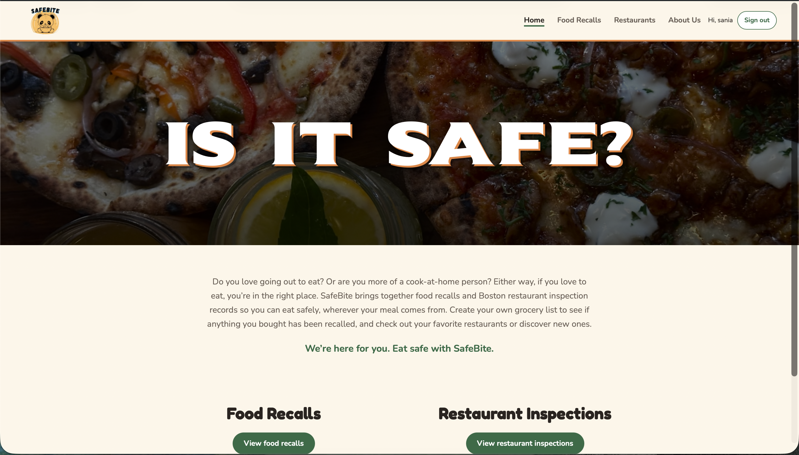
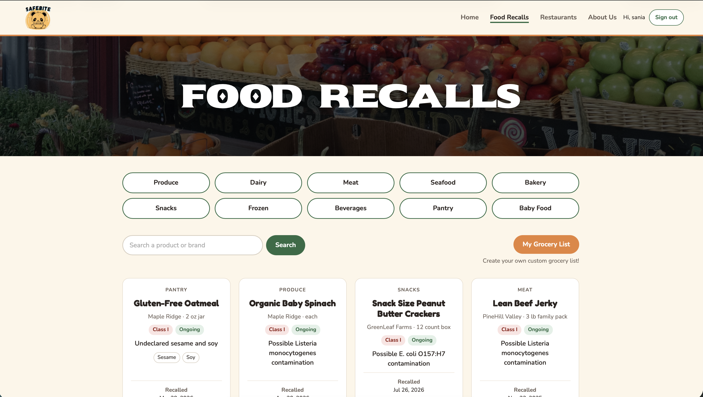
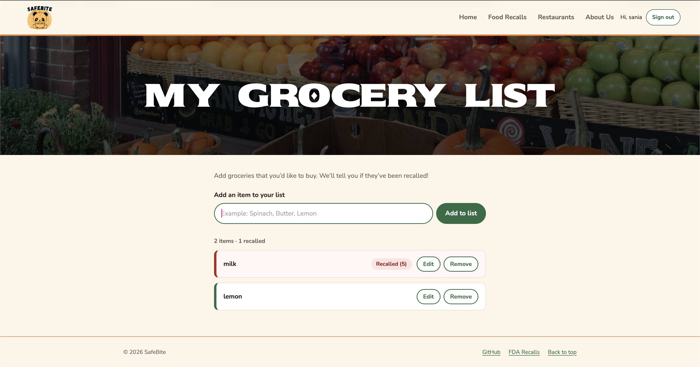
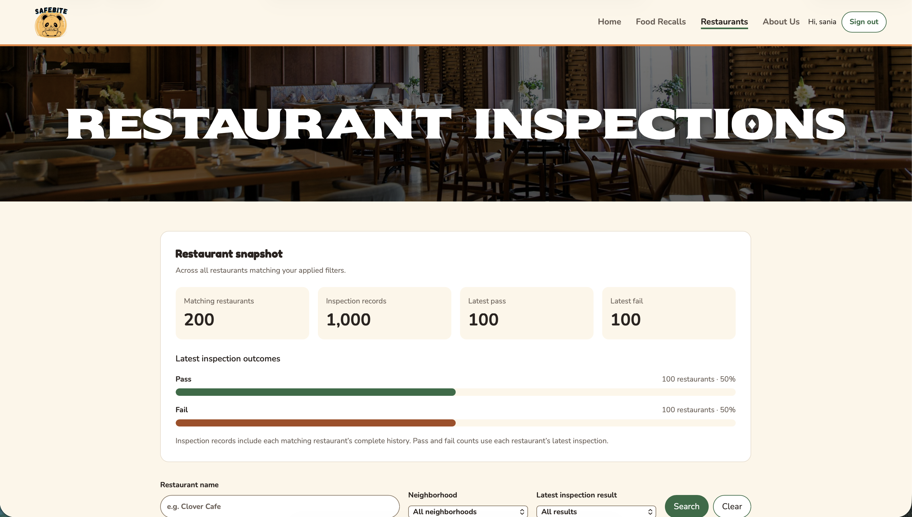
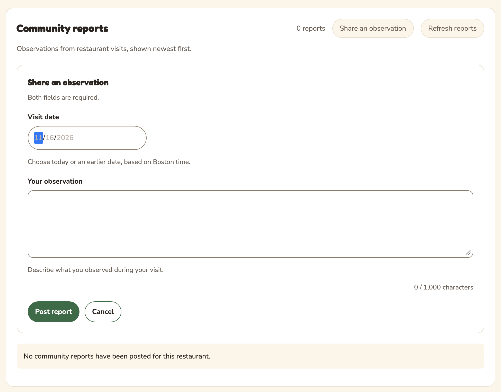
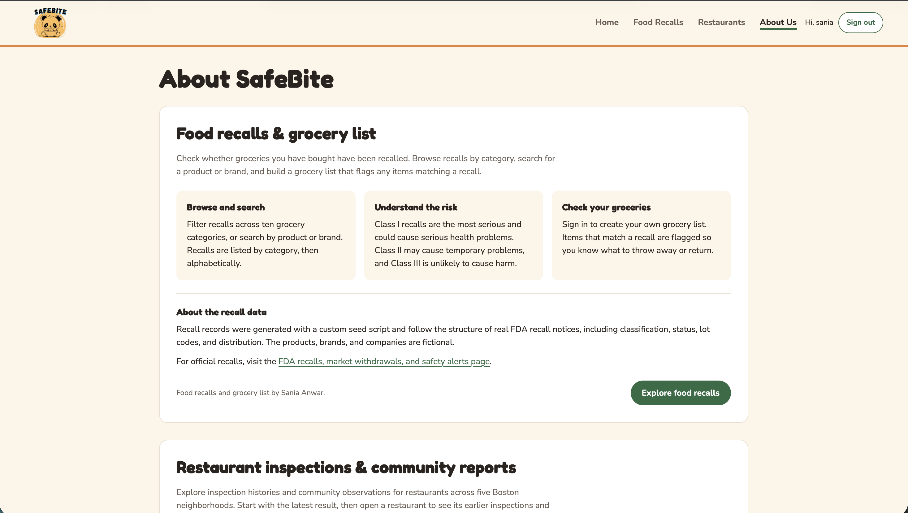
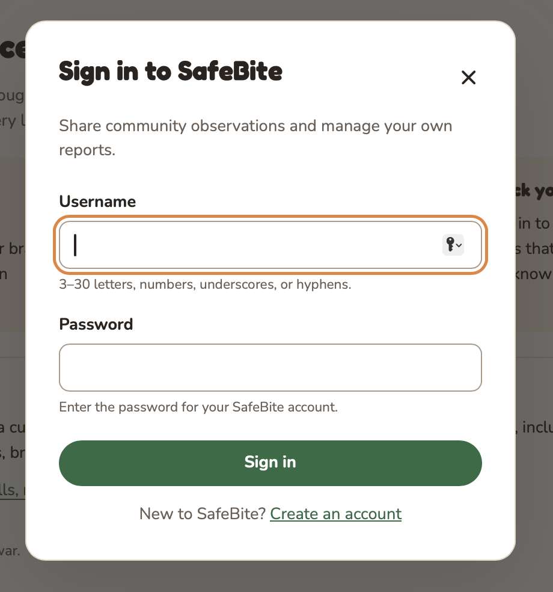
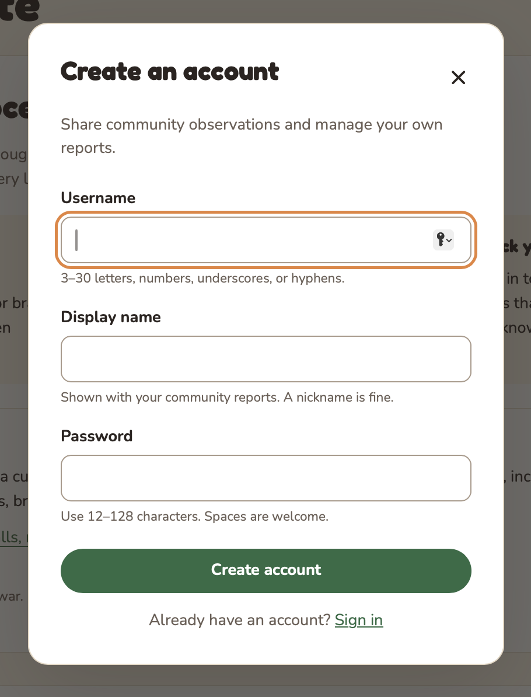

# SafeBite

**Is it safe? Check food recalls and Boston restaurant inspections in one place.**

A full-stack food safety application created for CS 5610: Web Development at Northeastern University.

SafeBite helps home cooks and people who eat out check whether the groceries they buy have been recalled and how Boston restaurants performed on their health inspections.

**Live Site:** [SafeBite](https://safebite-eupn.onrender.com)
**Repository:** [saniaanwar/safebite](https://github.com/saniaanwar/safebite)
**Course Page:** [CS 5610 — Web Development](https://johnguerra.co/classes/webDevelopment_online_fall_2026/)

## Screenshot



See all [screenshots](#screenshots) and the [design document](#design-documentation).

## Authors

### Sania Anwar

- **GitHub:** [saniaanwar](https://github.com/saniaanwar)
- **Responsibility:** Food Recalls and Grocery List.
- Includes the `recalls` and `groceryItems` collections, the recall seed script, the recalls and grocery list APIs, the Food Recalls page, and the Grocery List page with recall alerts.
- **Shared work:** project setup and GitHub repository, Home page, the Food Recalls section of the About page, and deployment on Render with MongoDB Atlas.

### John Paintsil

- **GitHub:** [kosolume](https://github.com/kosolume)
- **Responsibility:** Restaurant Inspections and Community Reports.
- ***Add in***
- **Shared work:** ***Add in***

## Project Objective

The goal is to build a useful, approachable application using React with hooks on the frontend and Node.js, Express, and MongoDB on the backend, as a client-side rendered app that loads data from the backend with AJAX.

The application has two feature areas:

- **Food Recalls and Grocery List:** browse synthetic food recalls by category or search, and keep a personal grocery list that flags any item matching an ongoing recall.
- **Restaurant Inspections and Community Reports:** ***Add in***

Each area supports its own create, read, update, and delete (CRUD) workflow on its own collection: grocery list items for Food Recalls, and community reports for Restaurant Inspections.

The project also demonstrates:

- React function components with hooks, each in its own file with PropTypes.
- CSS organized by component, with each component's CSS file loaded in its JSX file.
- Node.js and Express API development.
- MongoDB operations using the native driver (no Mongoose).
- Search, filtering, and pagination.
- User accounts with Passport local authentication.
- Semantic HTML controls and accessible navigation.
- ESLint, Prettier, and a Git/GitHub workflow.

## Pages

### Home

- Introduction to SafeBite and what it offers.
- Links to the Food Recalls and Restaurant Inspections pages.
- Shared navigation bar and site footer.

### Food Recalls

- 10 category filter buttons (Produce, Dairy, Meat, Seafood, Bakery, Snacks, Frozen, Beverages, Pantry, Baby Food), and product or brand search.
- Recall cards showing product, brand, package size, classification, status, reason, undeclared allergens, recall date, and what to do.
- Class I, II, and III badges color-coded by severity.
- 8 recalls per page with Previous/Next controls and a count ("Showing 9–16 of 1,008 recalls").
- Link to the Grocery List.

### Grocery List

- Signed-out users see a prompt to sign in.
- Signed-in users can add items, edit, and remove items.
- Each item is checked against **ongoing** recalls. A match opens a **RECALLED ITEM!** alert with the recall details and what to do.
- Lists are private to a user's account.

### Restaurant Inspections

***Add in***

### Supporting Pages

- **About:** overview of both feature areas, how the data was created, and links to official sources (FDA recalls and Boston inspection records).
- **Sign In / Sign Up:** ***Add in***

## Screenshots

| Page | Screenshot |
|---|---|
| Home |  |
| Food Recalls |  |
| Grocery List |  |
| Restaurant Inspections |  |
| Community Reports |  |
| About |  |
| Sign In |  |
| Sign Up |  |

## Technologies

- React with hooks (Vite) and React Router
- PropTypes
- HTML5 and CSS3 (Grid and Flexbox)
- Fetch API
- Node.js and npm
- Express
- MongoDB with the native MongoDB Node.js driver
- Passport (local strategy) with express-session and a MongoDB session store
- Git and GitHub
- ESLint and Prettier
- Render and MongoDB Atlas for deployment

The project does not use Mongoose, Axios, or CORS.

## Project Structure

| Location | Purpose |
|---|---|
| `backend/server.js` | Express app, sessions, Passport, and route setup |
| `backend/db/` | Database connection and collection queries |
| `backend/routes/` | API routes |
| `backend/middleware/` | Authentication, CSRF, and rate-limiting middleware |
| `backend/auth/` | Passport, password hashing, and session store |
| `backend/seed/` | Synthetic data seed scripts |
| `frontend/src/components/` | React components, each with its own CSS file |
| `frontend/src/components/recalls/` | Food Recalls page components |
| `frontend/src/components/grocery/` | Grocery List page components |
| `frontend/src/components/inspections/` | Restaurant Inspections page components |
| `frontend/src/components/auth/` | Sign-in and sign-up components |
| `frontend/public/` | Images and logo |

## Data

The database holds **2,008+ synthetic records**:

- **`recalls`:** 1,008 synthetic food recalls generated by `backend/seed/seedRecalls.js`. The records follow the structure of real FDA recall notices (classification, status, lot codes, distribution, retailers), but the products, brands, and companies are fictional.
- **`inspections`:** ***Add in***
- **`groceryItems`:** grocery list items created by users.
- **`reports`:** community reports created by users. ***Add in***
- **`users`** and **`sessions`:** accounts and login sessions.

For real recalls, see the [FDA recalls, market withdrawals, and safety alerts page](https://www.fda.gov/safety/recalls-market-withdrawals-safety-alerts). For real Boston inspections, see the [Boston food establishment inspections dataset](https://data.boston.gov/dataset/food-establishment-inspections).

## Design Documentation

Project description, user personas, user stories, and design mockups are in the [design document]([!!add doc link!!]).

## Installation and Local Development

**Prerequisites:** Node.js, npm, and a MongoDB server or MongoDB Atlas connection.

```bash
# Clone the repository
git clone https://github.com/saniaanwar/safebite.git
cd safebite

# Backend setup
cd backend
npm install
cp .env.example .env
node scripts/configureSession.js
```

Edit `backend/.env` and set `MONGODB_URI` to your MongoDB connection string. For local MongoDB, the example uses:

```
MONGODB_URI=mongodb://127.0.0.1:27017
MONGODB_DB=safebite
```

Seed the database and start the backend (from `backend/`):

```bash
node seed/seedRecalls.js
node seed/seedInspections.js
node server.js
```

The recall seed skips re-seeding if recalls already exist. Use `node seed/seedRecalls.js --force` to reset them.

In a second terminal, start the frontend:

```bash
cd frontend
npm install
npm run dev
```

Open `http://localhost:5173`. Vite forwards `/api` requests to the backend on port 3000.

**Production build:** run `npm run build` in `frontend/`, then `node server.js` in `backend/`. Express serves the built app at `http://localhost:3000`.

## Using the Application

### Food Recalls

1. Select **Food Recalls** in the navigation bar.
2. Click a category button to filter, and click it again to show all categories.
3. Search by product or brand name, such as "spinach", and press Enter or **Search**. Clear the box to show all recalls again.
4. Each card shows the recall's details. **Class I** (red) is the most serious, **Class II** (orange) may cause temporary health problems, and **Class III** (gray) is unlikely to cause harm.
5. Use **Previous** and **Next** to move between pages.

### Grocery List

1. Select **My Grocery List** on the Food Recalls page and sign in.
2. Type an item, such as "spinach", and select **Add to list**.
3. If the item matches an ongoing recall, a **RECALLED ITEM!** alert shows the matching recalls and what to do.
4. Use **Edit** to rename an item and **Remove** to delete it.
5. Select an item's **Recalled** badge to see its recall details again.

### Restaurant Inspections and Community Reports

***Add in***

## API Endpoints

### Recalls

| Method | Endpoint | Description |
|---|---|---|
| GET | `/api/recalls` | List recalls. Query: `search`, `category`, `classification`, `status`, `page`, `pageSize` (max 50) |
| GET | `/api/recalls/:id` | Get one recall |

### Grocery List (sign-in required; writes require a CSRF token)

| Method | Endpoint | Description |
|---|---|---|
| GET | `/api/grocery-items` | List your items, each with matching ongoing recalls |
| POST | `/api/grocery-items` | Add an item (`{ name }`) |
| PUT | `/api/grocery-items/:itemId` | Rename an item (`{ name }`) |
| DELETE | `/api/grocery-items/:itemId` | Remove an item |

### Authentication, Restaurants, and Reports

***Add in***

## Code Quality

ESLint and Prettier pass on both the frontend and backend.

```bash
# Format all files (from the repository root)
npx prettier --write .

# Lint the frontend and backend
cd frontend && npx eslint . && cd ..
cd backend && npx eslint . && cd ..
```

## Accessibility

Implemented considerations include:

- Semantic HTML and standard interactive controls (`<button>`, `<a>`, `<form>`, `<dialog>`).
- Skip-to-content link.
- Visible keyboard focus.
- Labeled inputs, including visually hidden labels for search fields.
- `aria-pressed` on category filter buttons.
- `role="alert"` for errors.
- A native `<dialog>` for the recall alert, which closes with Escape.
- Responsive layouts for desktop, tablet, and mobile.

## Peer Code Review

***In progress***

## Presentation and Demo Video

- **Slides:** [link]
- **Demo video:** [link]

## Generative AI Disclosure

### Tool and Model

- **Sania Anwar:** Claude (Anthropic)
- **John Paintsil:** ***Add in***

### How Generative AI Was Used

**Sania Anwar:** I used AI to help me generate the seed script for recalls. I looked over actual recall data on the FDA website and worked with Claude to build a similar seed script for my synthetic data. I also used Claude to help me with deployment on Render and MongoDB Atlas and to help organize the README.

**John Paintsil:** ***Add in***

## License

This project is licensed under the MIT License. See [LICENSE](LICENSE) for details.